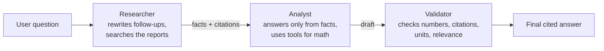

# Acba Reports Agent

A multi-agent RAG system that answers questions about **Acba Bank's 2025 Annual Report and audited IFRS financial statements**, with page-level citations. Built with **Google ADK + Gemini on Vertex AI**, served as a secured **FastAPI** service on **Google Cloud Run**.

**Live demo:** https://acba-agent-439066625395.us-central1.run.app

> Independent learning project. Not affiliated with Acba Bank. Answers come only from the bank's publicly available 2025 reports.

---

## What it does

Ask a question like *"What was Acba's net profit in 2025?"* and three specialized agents work in sequence:



Example answer:
> Acba Bank's net profit in 2025 was AMD 35.86 billion (Audited FS 2025, p. 12), which represents 35,856,026 thousand Armenian Drams. Verified.

Questions the reports can't answer (e.g. *"What was Acba's net profit in 2019?"*) get an honest "not found" instead of a guess.

## Results

| Metric | Result |
|---|---|
| Automated evaluation set (11 questions, run against the live service) | **11/11 (100%)**, including 2 "unanswerable" cases |
| Average latency on the eval set | **12.3 s** |
| Follow-up question ("And what about 2024?") | **88 s → 25 s**, searches 8 → 3, after query rewriting and code-enforced limits |
| Typical single question | **41 s → ~23 s** average |

How latency was reduced (details in the commit history):
1. **Query rewriting** — the researcher turns follow-ups into standalone questions before searching.
2. **Limits enforced in code, not prompts** — the search tool counts its own calls per question (`temp:` session state) and refuses after 3.
3. **Thinking and output budgets** — `thinking_level=LOW` and an output cap on simple steps (thinking tokens count toward the output limit).
4. **Consistent rules across agents** — source names are normalized in code, so the validator no longer "corrects" the analyst on every run.

## Features

- **Retrieval-augmented generation** over 431 PDF pages → 1,044 overlapping chunks, Gemini embeddings (`RETRIEVAL_DOCUMENT` / `RETRIEVAL_QUERY`), vectorized cosine-similarity search in NumPy.
- **Multi-agent pipeline** (Google ADK `Workflow`) with shared session state and conversation memory.
- **Grounded answers:** numbers only from retrieved text or tool calls; deterministic calculations via a Python tool; explicit unit handling (thousands vs billions of AMD).
- **API:** `POST /ask` for systems (API-key protected), `POST /chat` for the public page (per-IP rate limit, 429 when exceeded), `GET /health`.
- **Security:** API key stored in Google Secret Manager and injected at runtime; no secrets in Git or the container image; least-privilege service account; input length validation; `textContent` rendering in the UI (no XSS).
- **Monitoring:** per-request logs with latency and tool calls (Cloud Logging).
- **Evaluation:** `eval.py` scores the live service on a fixed question set with known answers.
- **CI:** GitHub Actions runs offline tests on every push (math, auth 401, unknown session 404, rate limit 429).
- **MCP server:** the search tool is also exposed via the Model Context Protocol, so any MCP client can use it.

## Tech stack

Python 3.13 · Google ADK · Gemini (Vertex AI) · Gemini embeddings · NumPy · pypdf · FastAPI · Pydantic · Docker · Google Cloud Run · Cloud Build · Artifact Registry · Secret Manager · GitHub Actions · pytest · MCP Python SDK

## Project structure

```
app.py                  FastAPI service: /ask, /chat (rate-limited), /health, chat page at /
bank_agent/
  agent.py              Researcher, analyst and validator agents + tools (Workflow pipeline)
  search.py             Vector search over the report chunks
build_index.py          PDFs -> chunks -> embeddings -> data/embeddings.npy + data/chunks.json
static/index.html       Chat page
eval.py, eval_set.json  Automated evaluation against a running service
mcp_server.py           MCP server exposing search_acba_reports
mcp_client_test.py      Small MCP client used to test the server
tests/                  Offline unit/API tests (run in CI)
Dockerfile              Container image for Cloud Run
.github/workflows/      GitHub Actions CI
learning/               Step-by-step learning scripts (Gemini API, manual tool calling, embeddings)
```

## Run locally

Requirements: Python 3.13, a Google Cloud project with the Vertex AI API enabled, and the gcloud CLI.

```bash
gcloud auth application-default login
python -m venv .venv && source .venv/bin/activate
pip install -r requirements.txt -r requirements-dev.txt
```

Create `.env` (never commit it):
```
GOOGLE_GENAI_USE_ENTERPRISE=1
GOOGLE_CLOUD_PROJECT=your-project-id
GOOGLE_CLOUD_LOCATION=global
BANK_API_KEY=any-long-random-string
```

Build the search index (only needed if the PDFs change), then start the server:
```bash
python build_index.py
uvicorn app:app --reload
```
Open http://127.0.0.1:8000 for the chat page, or http://127.0.0.1:8000/docs for the API.

## Tests and evaluation

```bash
pytest -q                                   # offline tests (no Gemini calls)

export EVAL_URL=http://127.0.0.1:8000       # or the Cloud Run URL
export EVAL_KEY=your-api-key
python eval.py                              # scores the agent on eval_set.json
```

## Deploy to Cloud Run

```bash
gcloud run deploy acba-agent --source . --region us-central1 \
  --allow-unauthenticated --memory 1Gi --max-instances 2 \
  --set-env-vars GOOGLE_GENAI_USE_ENTERPRISE=1,GOOGLE_CLOUD_PROJECT=your-project-id,GOOGLE_CLOUD_LOCATION=global \
  --set-secrets BANK_API_KEY=bank-api-key:latest
```
The service account needs `roles/aiplatform.user` and `roles/secretmanager.secretAccessor` on the `bank-api-key` secret.

## Known limitations and next steps

- The rate limiter is in memory, per instance; production would use a shared store (e.g. Redis) or a gateway such as Cloud Armor.
- Sessions are in memory and reset on restart; production would use a persistent session store.
- The evaluation set is small (11 cases) and string-based; next steps are more cases, trace checks, and LLM-as-judge grading.
- Financial tables are harder to retrieve than prose; table-aware chunking or hybrid (keyword + vector) search would help.
- Citations sometimes point to an adjacent page when a figure appears on several pages.

## Data sources

- Acba Bank Annual Report 2025 (English): https://acba.am/media/uploaded/Annual-Report-2025-eng.pdf
- Acba Bank audited IFRS consolidated financial statements 2025: https://acba.am/files/audit-report-2025-eng-1777360685-.pdf

## Author

Manvel Iskandaryan · B.S. Computer Science, University of Minnesota (Dec 2026)
[LinkedIn](https://www.linkedin.com/in/manvel-iskandaryan-72199831b) · [GitHub](https://github.com/iskan016-source)